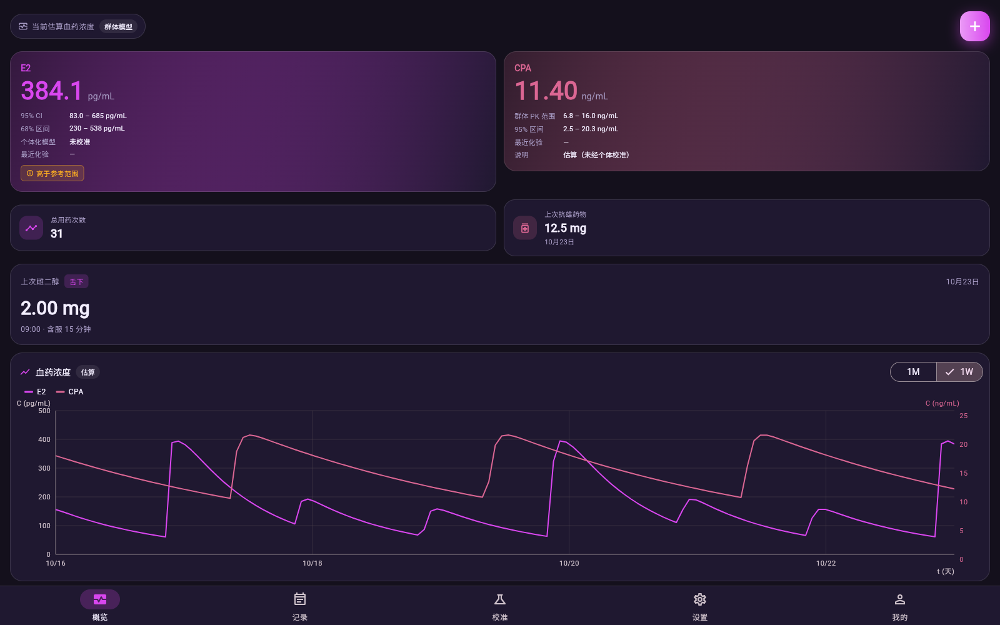
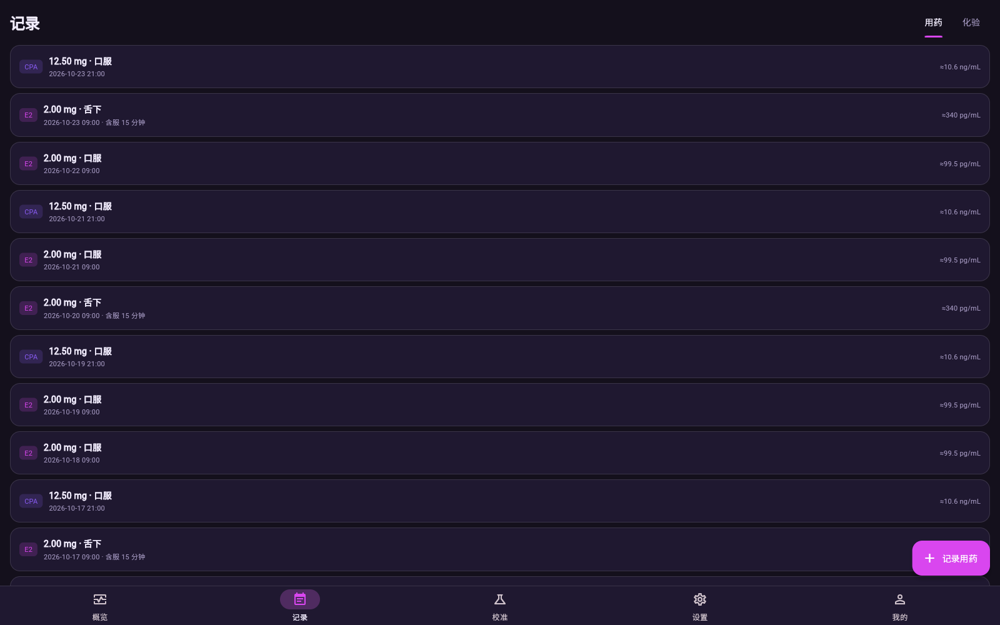
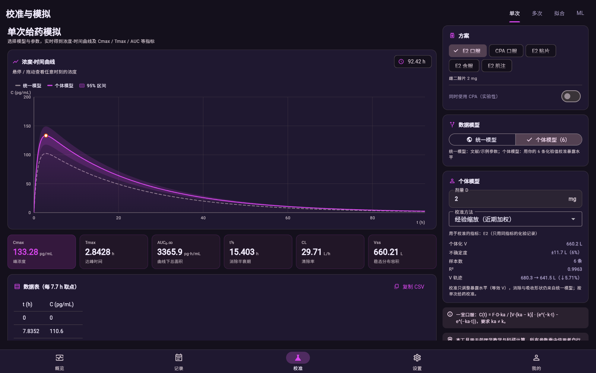
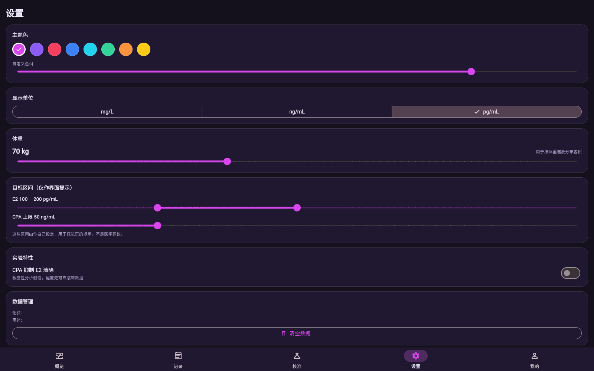
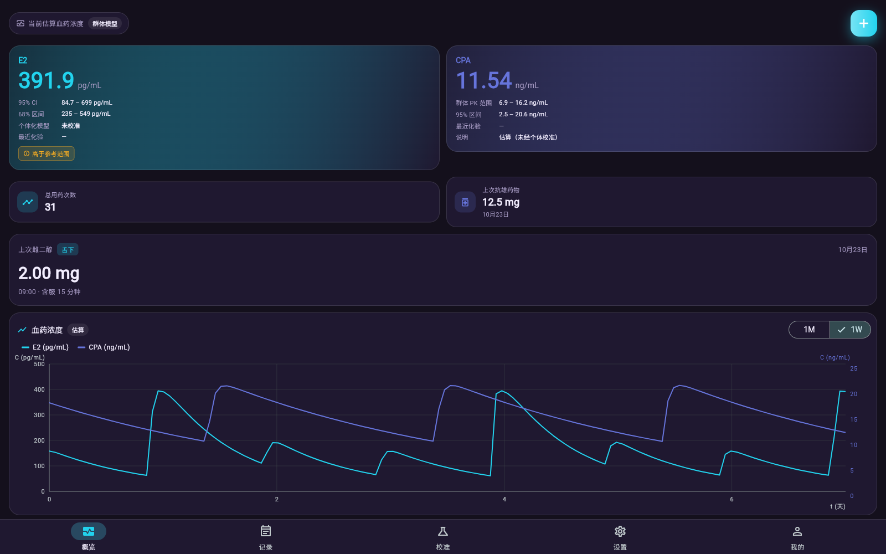
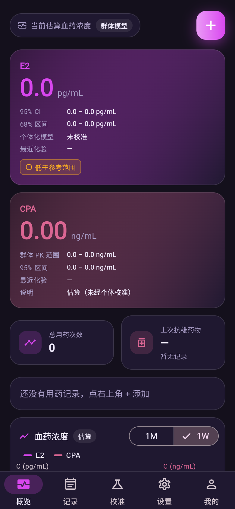
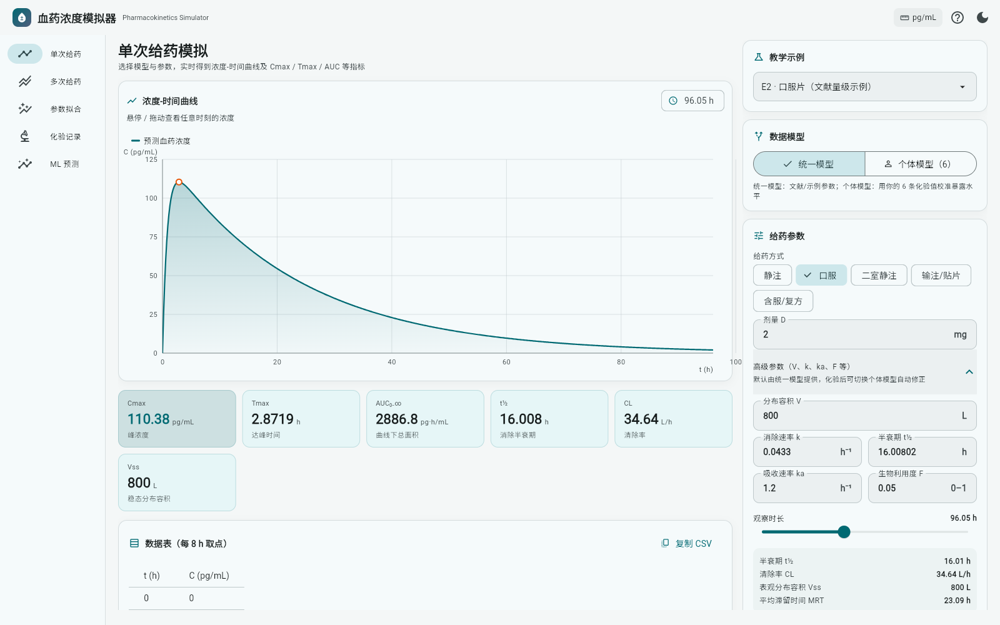

# HRT Recorder

一个用 **Flutter / Dart** 编写的 HRT 用药与血药浓度工具：记录用药与化验，按 5 个方案
推算当前浓度、区间与曲线，并用真实化验做个体校准。

全部核心算法（包括 Kalman / 贝叶斯校准和梯度提升树）都是**纯 Dart、零第三方依赖**实现，
同一套代码可以编译到 Web、Android 和 Windows 桌面。

> ⚠️ 本软件仅用于个人记录与趋势参考，不构成任何诊疗或给药建议。

## 界面

暗紫主题，底部五个 tab：**概览 / 记录 / 校准 / 设置 / 我的**。
中文界面（日期选择器也是中文）；手机宽度下页头与 tab 会自动分行，不会被截断。

设置里的**主题色**（8 个预设 + 自定义色相）、**体重**、**目标区间**、**校准方法**、
**实验开关**都会保存在本机，重启后保持不变；CPA 系列颜色由强调色自动派生。

| 概览 | 记录 |
| --- | --- |
|  |  |

| 校准 | 设置（主题色） |
| --- | --- |
|  |  |

| 换成青色主题 | 手机宽度 |
| --- | --- |
|  |  |

## 功能

| 页面 | 内容 |
| --- | --- |
| 概览 | 由用药记录叠加算出当前 E2 / CPA 浓度；E2 显示 95% / 68% 区间与个体化 V，CPA 显示群体范围；总用药次数、上次抗雄药、上次雌二醇；1W / 1M 双轴曲线（E2 pg/mL 左轴、CPA ng/mL 右轴） |
| 记录 | **用药记录**（时间、药物、途径、剂量、含服时长，可点按编辑、左滑删除）+ **化验记录**（日期、指标、数值、单位、距给药小时数，同样可点按编辑），都保存在本机 |
| 校准 | 单次给药 / 多次给药 / 参数拟合 / ML 预测四个子页（见下） |
| 设置 | 显示单位、体重、E2/CPA 目标区间、实验性 CPA 抑制开关、数据位置与清空 |
| 我的 | 功能说明、免责声明、隐私说明 |

**5 个方案**：E2 口服 2 mg / CPA 口服 12.5 mg / E2 贴片 100 µg/天 / E2 含服 2 mg / E2 肌注 5 mg。
分布容积按 **体重** 线性缩放（设置里可调），所以体重越大、同样剂量下浓度越低。

**图表**：同一张图里可以同时看到预测曲线、统一模型（虚线，个体模式下叠加）、
以及「个体差异带」——未校准时按 ±25/50/75% 手动设定，校准后换成数据驱动的 95% 区间。

**单位**：切换方案时自动用该方案的自然单位（E2 → pg/mL，CPA → ng/mL）。

**数值显示**：只有数量级 ≥ 10⁷（或 < 10⁻⁶，否则会被四舍五入成 0）时才用科学计数法，
其余一律普通小数——例如 `50000` 而不是 `5.00e4`。

## 校准子页

| 页面 | 内容 |
| --- | --- |
| 单次给药 | 选方案 + 体重 + 剂量，看单次曲线、Cmax、Tmax、AUC₀₋∞、t½、CL、Vss、MRT；V/k/ka/F 收在「高级参数」 |
| 多次给药 | 固定间隔 τ 重复给药；稳态峰谷、波动度 FI、蓄积比 R、达稳时间、AUCτ |
| 参数拟合 | 粘贴实测数据，四种模式：口服 / 静注 / 储库 / 含服 |
| ML 预测 | 纯 Dart 的 XGBoost 风格梯度提升树代理模型 |

<details>
<summary>展开后的「高级参数」</summary>



</details>

## 数据模型：统一 → 个体

**统一模型**（默认）：用文献/示例参数模拟，适合还没做过化验、或想先看趋势的时候。

**个体模型**：当某个方案对应的指标（E2 / CPA）积累了 **≥ 4 条**带「距上次给药 (h)」的
记录后，「数据模型」会自动切到个体模型（也可以手动切回统一模型）。
**只用同一指标的记录**——CPA 方案不会拿 E2 的化验值去校准。它做的事是：

### E2 的四种校准引擎

| 方法 | 原理 | 特点 |
| --- | --- | --- |
| 经验缩放（默认） | 加权中位的「实测/预测」比例，权重按记录新旧半衰 90 天衰减 | 最稳，近期化验影响更大 |
| OU-Kalman 动态校准 | ln V 的均值回复随机过程 + 线性 Kalman 滤波 | 给出 V 随时间的轨迹；观测对 ln V 是线性的，无需线性化 |
| EKF 参数学习 | 状态 [ln V, ln k]，数值雅可比 | k 在稀疏采样下几乎不可辨识，结果主要由先验决定 |
| 贝叶斯 MAP（实验） | 先验 + 似然的最优后验，Laplace 近似求不确定度 | 实验特性，样本少时后验≈先验 |

校准后的预测带改为**数据驱动的 95% 区间**（未校准时仍是手动的 ±25/50/75%）；
区间有 6% 的下限，因为单室近似和 E1S 储库带来的模型误差不会因为化验准而消失。

### 实验性：CPA 抑制 E2 清除

E2 方案下可以打开「同时使用 CPA（实验性）」开关，按设定的百分比降低 E2 的清除率
（默认 −25%）。**这是一个敏感性分析假设，不是已确立的临床相互作用**，幅度没有可靠数据，
界面上有明确提示。

1. 用统一模型在该方案下预测你每条化验点所在时刻的浓度；
2. 取「实测/预测」比例的中位数作为校准系数（用中位数，避免个别异常值带偏）；
3. 把整条曲线按系数缩放 —— 等价于调整个体表观分布容积 V（C ∝ 1/V）。

单次给药页按「单次」校准，多次给药页按「稳态方案（当前 τ）」校准——化验通常是在稳态下
采的，所以贴片/凝胶用户请用多次给药页。

**为什么只校准暴露水平、不拟合 ka/k？**
4–10 个化验点不足以同时定出吸收、消除、分布三个维度；硬拟合会得到看似精确、实际不可信
的参数（而且口服公式里 ka 与 k 本身是对称不可辨识的）。只校准一个系数，结果稳定，并且
R² 能诚实地告诉你「形状对不对」——R² 低于 0.6 时界面会提示你去检查给药方案与采血时间。

| 参数 | 说明 |
| --- | --- |
| 校准系数 | 实测浓度 / 统一模型预测，>1 表示你比模型高 |
| 样本数 | 参与校准的记录条数（≥ 4） |
| R² | 校准后曲线对化验点的决定系数 |
| 个体化 V | 等效调整后的表观分布容积 |

## 化验记录与本地存储

「化验记录」页用于保存真实化验值，并和模型曲线对照：

- 每条记录：采血时间、指标（E2 / CPA / 自定义）、数值与单位、距上次给药小时数（可选）、备注
- 趋势图按指标筛选，单位可在 pg/mL、ng/mL、mg/L 间切换
- 支持 CSV 导出（复制到剪贴板）与导入（粘贴回填），方便换设备或备份
- 填了「距给药 (h)」的记录，可以在「参数拟合」页一键导入，直接和模拟曲线比较

**存储位置**（全部在本机，不经过任何服务器）：

| 平台 | 位置 |
| --- | --- |
| Windows | `%APPDATA%\pk_sim\lab_records.json` |
| Android | 应用私有目录 `pk_sim/lab_records.json` |
| Web | 浏览器 `localStorage`，键 `pk_sim_lab_records_v1` |

存储层是零依赖实现：原生走 `dart:io` 写文件，Web 走 `dart:js_interop` 调 `localStorage`
（没有引入 `shared_preferences` 等插件）。

> 这些数据是敏感的个人健康信息。软件不做任何联网上报；记录以明文 JSON 保存，
> 依赖系统账户权限保护（未额外加密）。网页版本的数据留在浏览器配置里，清理浏览器
> 数据会一并清除，重要记录建议定期导出 CSV 备份；共用电脑上请使用系统账户隔离。

## 环境

| 组件 | 版本 / 位置 |
| --- | --- |
| Flutter SDK | 3.47.7 stable → `C:\DevTools\flutter`（已加入用户 PATH） |
| Dart SDK | 3.13.5（随 Flutter 提供，`C:\DevTools\flutter\bin\cache\dart-sdk`） |
| JDK | Temurin/Microsoft JDK 21 → `C:\DevTools\jdk-21`（`JAVA_HOME` 已设置） |
| Android SDK | `C:\DevTools\android-sdk`（platform-tools、platforms;android-36、build-tools;36.0.0） |
| Git (MinGit) | `C:\DevTools\git`（Flutter 工具链需要） |
| VS Code 扩展 | `Dart-Code.dart-code` 已安装 |

> Flutter 编译 **Windows 原生 exe** 还需要 Visual Studio 的「使用 C++ 的桌面开发」工作负载，
> 本机尚未安装；Web 与 Android 不受影响。

## 运行

```powershell
cd C:\Users\王\Documents\deepseek-harness\default-workspace\pk_sim

# 浏览器（本机只装了 Edge，已把 CHROME_EXECUTABLE 指向 msedge，两种写法都可用）
flutter run -d chrome
flutter run -d edge

# Android 真机 / 模拟器
flutter devices
flutter run -d <device-id>

# 构建产物
flutter build web --release      # → build\web

# APK：本工程路径含中文，Flutter 的 AOT 快照器无法处理，
# 请用脚本（会先镜像到 C:\DevTools\pk_sim_build 再打包）
powershell -ExecutionPolicy Bypass -File .\scripts\build_apk.ps1
# → build\app\outputs\flutter-apk\app-release.apk
```

> 直接在该中文路径下执行 `flutter build apk --release` 会报
> `Unable to read file: ...app.dill`，这是 gen_snapshot 的已知限制；
> `scripts\build_apk.ps1` 已经处理好了。

已经构建好的直接体验方式：

```powershell
# Web：任意静态服务器指向 build\web
python -m http.server 8089 --directory build\web
# 然后浏览器打开 http://127.0.0.1:8089
```

## 目录结构

```
lib/
├── core/                 纯 Dart 计算核心（与 UI 无关，可单独测试）
│   ├── pk.dart           房室模型、单次/多次给药叠加、Cmax/Tmax/AUC/稳态指标
│   ├── fitting.dart      Nelder–Mead、加权最小二乘参数反推
│   ├── gbdt.dart         XGBoost 风格梯度提升树（二阶泰勒 + 正则化分裂增益）
│   └── dataset.dart      合成训练集、CSV 解析、演示数据
├── ui/
│   ├── app.dart          主题、导航骨架
│   ├── pages/            四个功能页
│   └── widgets/          自绘曲线图、参数面板、指标卡、响应式布局
└── utils/format.dart     数值格式化与坐标轴刻度
test/                     35 个单元 / 组件测试
```

## 模型与公式

**一室静注**

$$C(t)=\frac{D}{V}e^{-kt},\quad t_{1/2}=\frac{\ln 2}{k},\quad AUC_{0\to\infty}=\frac{D}{CL}$$

**一室口服（一级吸收）**

$$C(t)=\frac{F D k_a}{V(k_a-k)}\left(e^{-kt}-e^{-k_a t}\right)$$

（$k_a \to k$ 时自动切换为极限形式 $C(t)=\frac{FD}{V}kt\,e^{-kt}$，避免除零）

**二室静注** —— 由 $V_1,k_{10},k_{12},k_{21}$ 推出宏参数：

$$\alpha,\beta=\frac{(k_{10}+k_{12}+k_{21})\pm\sqrt{(k_{10}+k_{12}+k_{21})^2-4k_{10}k_{21}}}{2}$$

$$C(t)=Ae^{-\alpha t}+Be^{-\beta t},\quad A+B=\frac{D}{V_1},\quad V_{ss}=V_1\left(1+\frac{k_{12}}{k_{21}}\right)$$

**恒速输入（输注 / 透皮贴片）** —— 输入速率 $R_0 = D/T$：

$$C(t)=\frac{R_0}{CL}\left(1-e^{-kt}\right)\ (0\le t\le T),\qquad
C(t)=C(T)\,e^{-k(t-T)}\ (t>T),\qquad C_{ss}=\frac{R_0}{CL}$$

**双吸收相（含服 / 速释+缓释复方）** —— 两个一级吸收项并联：

$$C(t)=\frac{F_1 D k_{a1}}{V(k_{a1}-k)}\left(e^{-kt}-e^{-k_{a1}t}\right)
+\frac{F_2 D k_{a2}}{V(k_{a2}-k)}\left(e^{-kt}-e^{-k_{a2}t}\right),\quad F_1+F_2=F$$

**多次给药** 用叠加法（superposition）：

$$C_{\text{total}}(t)=\sum_{i=0}^{n-1}C(t-i\tau)$$

稳态用无限历史剂量叠加，$C_{ss,max}=C_0/(1-e^{-k\tau})$，蓄积比 $R=1/(1-e^{-k\tau})$，
波动度 $FI=(C_{ss,max}-C_{ss,min})/C_{ss,avg}$。

AUC 用复合 Simpson 积分；Tmax 用网格定位 + 黄金分割精修。

## 关于 E2 / CPA 这类药

模型本身是通用线性房室模型，能不能用取决于药物和给药途径是否符合假设：

| 场景 | 界面对应方案 | 说明 |
| --- | --- | --- |
| CPA 口服 | CPA 口服 | 吸收完全、单室线性、t½ 约 1.5–2.5 天，拟合度较好 |
| E2 口服片 | E2 口服 | 只能得到「表观」参数：首过代谢强（F 仅百分之几），E1/E1S 储库造成的终末拖尾单室模型无法描述 |
| E2 含服 / 舌下 | E2 含服 | 粘膜快吸收 + 吞咽部分慢吸收，单相模型无法同时压住早期尖峰和后段。快相 ka1 约 3–8 h⁻¹，慢相 ka2 约 0.4–1 h⁻¹，F 约 0.1–0.25 |
| E2 透皮贴片 | E2 贴片 | 贴片是零级输入；换片时用多次给药的 τ = 佩戴时长叠加 |
| E2 肌注储库 | E2 肌注 | 释放限速（flip-flop）；拟合时选「储库」模式并填入已知的消除常数 k，否则 ka/k 不可辨识 |

单条曲线无法区分 ka 与 k 谁大谁小（两个方向拟合出的曲线完全一样），因此储库拟合必须
固定 k；含服的双吸收相同理，ka1 与 F1 高度相关，拟合时固定 k 与 ka1——这些限制在对应
模式里已经处理。

尚未建模的因素：内源性基线分泌、SHBG 结合（游离 vs 总浓度）、肠肝循环、个体差异。
所以**绝对浓度只能作趋势参考**，真实水平请以化验结果为准。

## 测试

```powershell
flutter test        # 60 个测试：公式正确性、拟合还原度、零级输入、储库/含服拟合、单位换算、化验记录序列化、个体校准、GBDT、CSV、界面冒烟
flutter analyze     # 0 issue
```

关键测试用例把数值解与解析解对比，例如静注 $AUC_{0\to\infty}=D/CL$、
二室 $AUC=D/(V_1 k_{10})$、稳态峰浓度 $C_0/(1-e^{-k\tau})$，误差都在 0.1% 以内。

## 免责声明

本项目为教学/科研演示，参数为示例值，不可用于临床决策。
